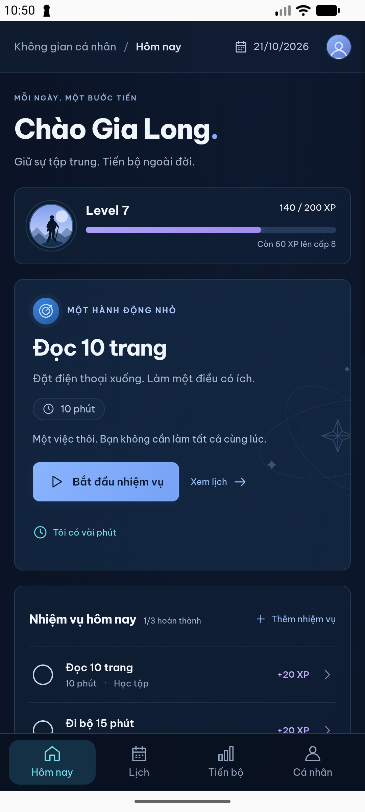
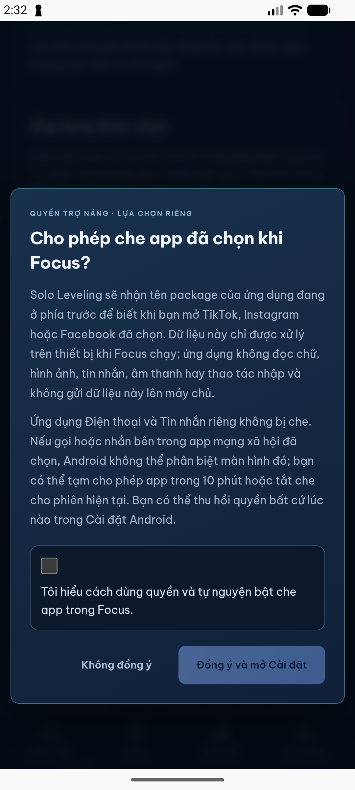
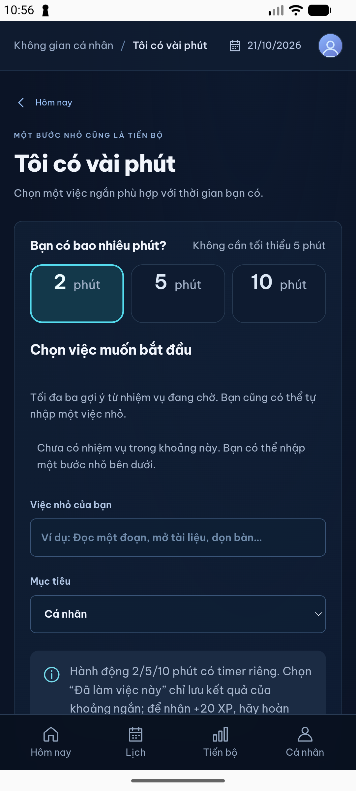

# Bằng chứng sử dụng và kiểm thử

Tài liệu này tổng hợp bằng chứng kỹ thuật có thể tái tạo. Ảnh được chụp từ AVD Android trong phiên kiểm thử ngày 21/10/2026, dùng dữ liệu trải nghiệm minh họa; chúng không phải ảnh khách hàng hoặc bằng chứng về người dùng ngoài nhóm phát triển.

## Ảnh demo Android

## Kiểm chứng hiện có

- `npm run check` và `npm run build`: đạt trong lần kiểm tra ghi tại [VERIFICATION.md](VERIFICATION.md).
- Backend pytest: 19 test đạt trong lần kiểm tra gần nhất được ghi nhận.
- Android `assembleDebug`: APK debug build được và cài/mở trên AVD `emulator-5554`; ảnh ghi lại trang Hôm nay, mục tiêu, thao tác ngắn và màn hình consent.
- Từ chối consent giữ bảo vệ ở trạng thái tắt. Chế độ chặn chỉ bật khi người dùng tự đồng ý, chọn app và Focus đang chạy.

## Giới hạn bằng chứng

- AVD không cài TikTok/Instagram/Facebook và chưa được cấp Usage Access/Accessibility trong lần QA được ghi nhận. Vì vậy chưa có xác minh end-to-end nhắc/che trên app thật.
- iOS project chưa được build bằng Xcode; iOS Screen Time restriction chưa được triển khai/entitlement.
- Ảnh dùng seed/demo content; không đại diện cho phiên làm việc của người dùng thật. Dự án chưa thu thập hoặc xác nhận số lượt tải, active users, retention, contribution từ cộng đồng hay phản hồi production.
- Không dùng số phút timer làm số liệu năng suất đã xác minh. Timer không tự đánh dấu nhiệm vụ hoàn thành hoặc cấp XP.

Để lặp lại kiểm tra cục bộ, xem [lệnh phát triển và kiểm thử](../README.md#phát-triển-và-kiểm-thử) và [báo cáo kiểm chứng đầy đủ](VERIFICATION.md).
